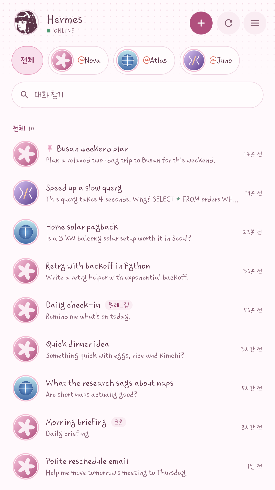
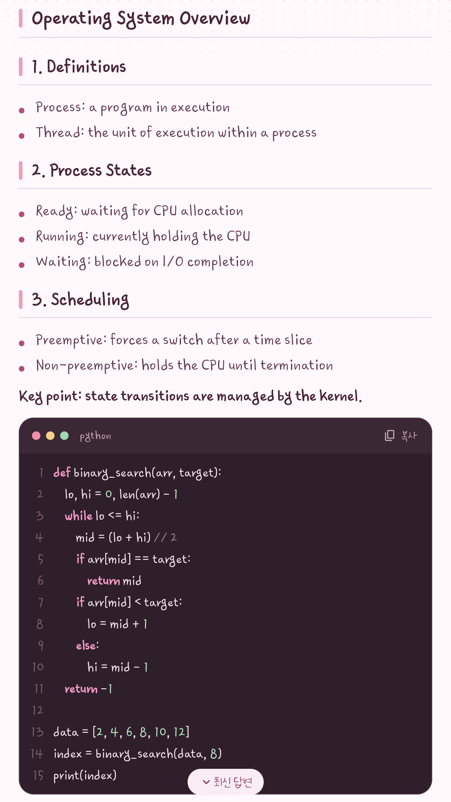
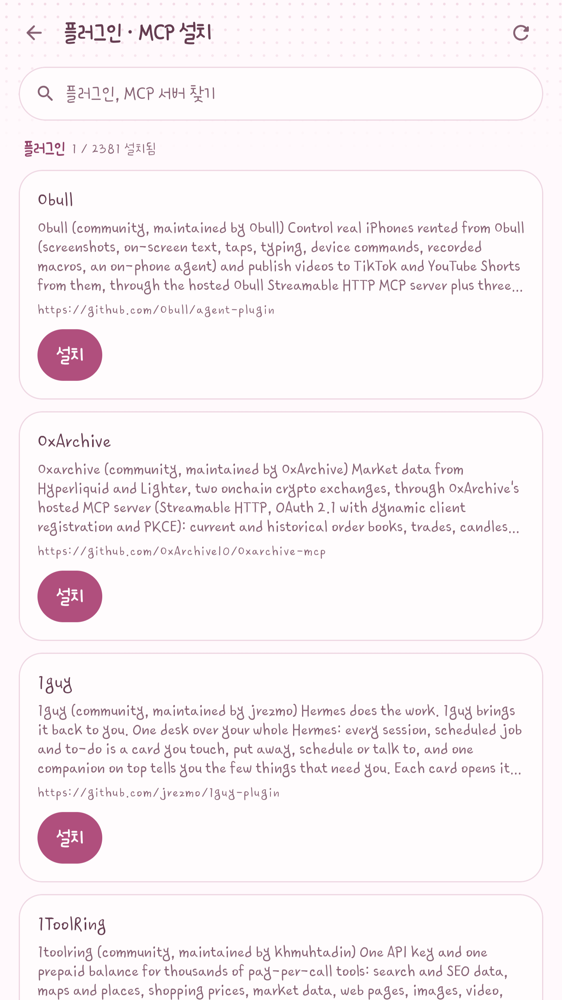
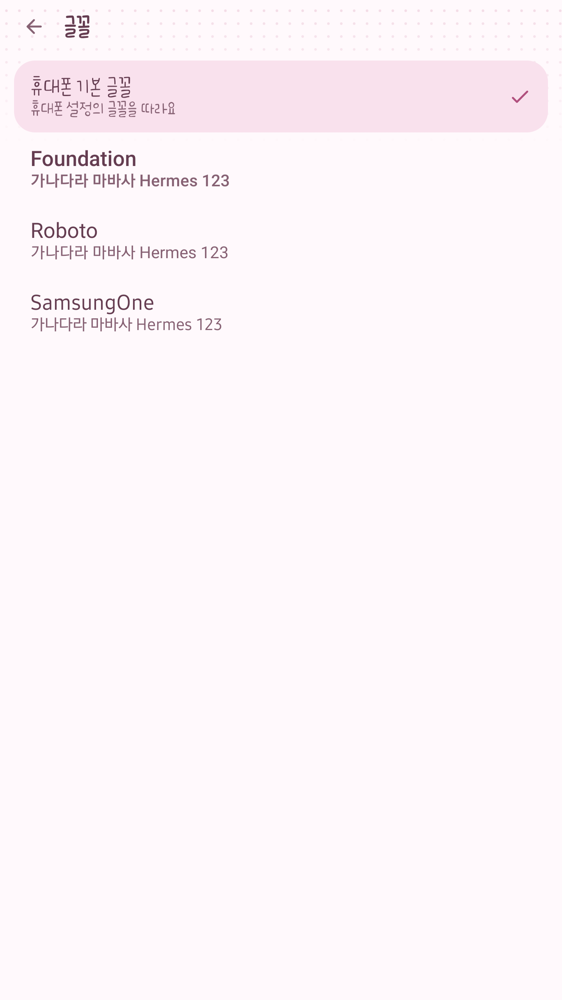

<div align="center">


# Hermes Next for Android

**A native Android companion for the official [Hermes Agent Webapp](https://github.com/NousResearch/hermes-agent): chats, background alerts, and a quick assistant without waiting for a web page.**

[](https://github.com/zimza1abim/hermes-next-android/releases/latest)
[](#requirements)
[](#build-from-source)
[](LICENSE)

[Download](#download) ·
[Native chats](#native-chats) ·
[Background alerts](#background-alerts) ·
[Quick assistant](#quick-assistant) ·
[Build](#build-from-source)

</div>

---

Hermes Next is a fork of
[hermes-webui/hermes-android](https://github.com/hermes-webui/hermes-android).
It keeps the upstream hardened WebView for sign-in and the official Webapp,
then adds a native chat client and a gateway monitor for the parts of Hermes
you need on a phone.

## Screenshots

### Main tab



### Conversation



### Plugins and MCP



### Font selection



| | |
|---|---|
| **Package ID** | `dev.hermes.next` |
| **Current version** | `1.0.0` (version code `10000`) |
| **Android support** | Android 8.0 / API 26 or later; target SDK 37 |
| **Native mode requires** | A signed-in official Hermes Agent Webapp with its gateway enabled |
| **Gateway endpoints** | `/api/webapp/socket-ticket` and `/api/ws` |

## Download

Download the APK from [GitHub Releases](https://github.com/zimza1abim/hermes-next-android/releases/latest).
It installs alongside upstream Hermes (`com.hermeswebui.android`) because it
uses a separate application ID. After installing, enter your server address and
sign in on the server's own page.

Only install an APK whose source and signing identity you trust. Releases and
their checksums are the authoritative distribution channel for this project.

## Requirements

You need a Hermes Agent server that you can already sign in to. For the native
chat and background-monitor features, use the official Hermes Agent Webapp
with the gateway endpoints above available to the phone.

Use HTTPS or a trusted VPN/private network when connecting away from home. Do
not expose an unauthenticated Hermes server directly to the public internet,
and do not save a short-lived sign-in URL as the server address.

The embedded WebView remains available for sign-in and for Webapp features not
yet offered natively. Hermes WebUI deployments can still use the upstream
WebView experience; the native-chat features are built for the official
Webapp gateway.

### Server setup help

The first-run guide can copy either of the following prompts. Paste one into an
existing Hermes chat on the computer or server that runs Hermes—not into a
terminal and not on the phone. Copying a prompt does not install anything or
verify that the phone can reach the server.

**Copy command to set up WebUI** (paste into Hermes chat):

```text
Help me set up Hermes WebUI for the Hermes-Android app on my phone. Work on the computer/server that runs my existing Hermes Agent, not on the Android phone. First check the operating system, existing Hermes/WebUI installations, active profile, ports and network access. Preserve my models, credentials, conversations and configuration; do not reinstall or overwrite a working setup.

Read https://github.com/nesquena/hermes-webui and its docs/onboarding-agent-checklist.md for current instructions. Reuse an existing WebUI installation. If it is missing, explain the installation plan and ask before installing dependencies or downloading/running installers. The documented bootstrap uses git clone https://github.com/nesquena/hermes-webui.git hermes-webui, then cd hermes-webui and python3 bootstrap.py; native Windows needs a supported alternative such as WSL2. Check compatibility instead of blindly running these commands.

Help me choose safe phone access using an existing trusted VPN such as Tailscale, an SSH tunnel, or an authenticated HTTPS reverse proxy. Localhost/127.0.0.1 on my phone is the phone, not this server. Keep authentication enabled. Do not expose an unauthenticated service, open router ports, disable TLS verification or change firewall/network settings without explaining the risks and asking me first. Prefer HTTPS for microphone and browser features.

Verify the server's health and sign-in locally, then guide me through a phone-side connection check; do not claim phone reachability from a localhost check. Give me the reusable server URL to paste into Hermes-Android, simple sign-in steps and how to stop/restart the service. Never include passwords, API keys, bearer tokens or one-use login links in the saved URL or your response. If access or a check is unavailable, state what remains unverified.
```

**Copy command to set up Hermes WebApp** (paste into Hermes chat):

```text
Help me enable the official Hermes Agent WebApp (the browser-hosted Desktop workspace) for the Hermes-Android app on my phone. This is not the admin Dashboard and does not require the separate Hermes WebUI repository. Work on the computer/server running my existing Hermes Agent, not on the Android phone. Check the installed version, active profile, gateway state and network access first. Preserve my credentials, conversations, models and working configuration.

Read https://hermes-agent.nousresearch.com/docs/user-guide/desktop and the linked Webapp configuration/authentication documentation for the installed version. The basic host commands are hermes config set webapp.enabled true and hermes webapp. Explain the plan and ask before updating Hermes, downloading/building dependencies or restarting a gateway that may have active chats. Use the existing profile and do not install Hermes WebUI as a substitute.

For phone access, prefer Desktop Settings > Web Access with authenticated HTTPS through my existing trusted VPN/reverse proxy. A same-host proxy can keep the Webapp on loopback and use webapp.public_url; other topologies need their documented configuration. Do not blindly bind to 0.0.0.0: non-loopback access requires the documented sign-in gate. Do not expose unauthenticated access, forward router ports, disable TLS verification or change firewall/network settings without explaining risks and asking first. WebApp access can run commands and access files as the host user.

Verify hermes webapp --status and the sign-in flow, then guide me through a phone-side connection check. Localhost/127.0.0.1 on my phone is not this server. Give me the reusable HTTP(S) server URL to save in Hermes-Android and simple sign-in steps. Keep temporary one-use sign-in links, passwords, API keys and tokens private and out of the saved URL and your response. Prefer HTTPS for microphone and browser features. If any setup or phone check cannot be verified, say what remains.
```

## Native chats

The launcher opens native Compose screens by default. They use the Hermes
gateway socket and HTTP API directly, so chat changes stay in sync with the
Webapp and other devices.

| Area | Available now |
|---|---|
| **Chats and bots** | All chats ordered by recent activity, bot tabs, swipe navigation, and title/text search |
| **Chat actions** | Rename, pin, archive, restore, and delete; all are written back to the server |
| **Conversations** | Streaming answers, stop, command approvals, photos, model and reasoning selection |
| **Output** | Markdown with headings, lists, quotes, tables, and code blocks with line numbers and copy |
| **Server tools** | Cron run/pause/resume; searchable skills, tools, MCP servers, plugins, and install catalogs |
| **Appearance** | A phone font selection applied before the first native frame |

Select **Open Webapp** from the menu for a feature the native screens do not
cover. **Start on this screen** switches the launcher back to the Webapp.

> [!NOTE]
> The Hermes gateway protocol is not a public stable API. A Hermes Agent
> update can require a matching Hermes Next update.

## Background alerts

Android can keep a foreground service alive while the app is not visible.
Hermes Next uses that allowance for its own gateway monitor instead of relying
on a hidden WebView renderer. It watches active chats, reconnects with replay
cursors after a drop, and posts native alerts for completed, failed, stopped,
approval, question, and background-task events.

Alerts are grouped by chat and keep previews private on the lock screen. When
the gateway supports it, notification actions let you allow/deny a command,
choose an answer, or reply without opening the app. An action is displayed as
sent only after the gateway confirms it; uncertain sends stay clearly marked
so they cannot be accidentally repeated.

For reliable delivery, enable **Stay connected in the background** and, on
aggressive devices such as some Samsung models, grant **Unrestricted battery
use** in the app's notification/background settings. Android can still refuse
a background start; Hermes Next shows a *Background alerts stopped* notice
instead of silently claiming that monitoring is active.

### Optional gateway hook

[`gateway-patches/hermes-android-ack/`](gateway-patches/hermes-android-ack/)
contains an optional startup hook for the machine running the Hermes gateway.
It adds delivery receipts for notification replies and avoids updating a chat's
last-active time when the monitor attaches as a viewer.

```sh
mkdir -p ~/.hermes/hooks/hermes-android-ack
cp gateway-patches/hermes-android-ack/{HOOK.yaml,handler.py} \
  ~/.hermes/hooks/hermes-android-ack/
```

Restart the gateway and check its log for `Loaded hook 'hermes-android-ack'`.
Without this hook, alerts still work, but a notification reply may remain
unconfirmed. Recheck the hook after every Hermes Agent update because it
depends on gateway internals.

## Quick assistant

**Ask Hermes** is a compact panel that opens over another app. Start it from a
launcher shortcut, Android's text-selection menu, or an automation/activity
launcher. It can draft a question, search, translate, summarize, and attach up
to four photos. Sending always requires your tap.

The panel creates a separate chat, streams its answer, supports approvals, and
can hand the conversation to the native chat screen. A free-form question that
needs a fuller context opens in the app.

## Privacy and security

- The app communicates with the Hermes server you configure. It has no
  advertising or analytics SDK.
- Sign-in and authorization remain on the server's own pages. Cookies and
  settings are stored locally; secure the phone and the server route.
- Notification previews are configurable. With previews disabled, question
  alerts do not offer answer buttons.
- WebView navigation, external intents, download handoff, OAuth returns, and
  notification actions have separate origin and trust checks. Do not treat a
  cosmetic server label as a security signal.
- The project accepts user-installed certificate authorities for managed/private
  deployments, but it does not bypass certificate or hostname validation.

## Known limits

- A turn that starts and finishes between monitor discovery intervals can be
  missed if the chat was not already being watched.
- The monitor follows the active gateway profile; bot chats in another profile
  are not watched in the background.
- A prompt answered on another device may stay visible until you open Hermes;
  the gateway does not emit a dismissal event for every remote action.
- Some account, provider, and advanced configuration workflows remain Webapp-only.

## Build from source

Install JDK 17 and the Android SDK, then use the included Gradle wrapper:

```sh
./gradlew testDebugUnitTest assembleDebug
```

The F-Droid-oriented `release` build has no Google Play dependencies:

```sh
./gradlew verifyFossDependencies assembleRelease
```

To stage a signed GitHub-release APK, create an untracked
`keystore.properties` in the repository root:

```properties
storeFile=/path/to/release.jks
storePassword=…
keyAlias=…
keyPassword=…
```

Then run:

```sh
./gradlew stageReleaseArtifacts
```

The staged artifact is `build/release/hermes-next-v<version>-github.apk`.
Install a compatible signed update with `adb install -r <apk>` to keep local
app data; a different signing key is a different Android app identity.

### Release metadata

- Version name: `1.0.0`
- Version code: `10000`

`tools/bump_version.py` keeps the version, F-Droid changelog, roadmap, and the
two lines above aligned for a release. See [RELEASE.md](RELEASE.md) for the
full publishing checklist.

## Project map

| Path | Responsibility |
|---|---|
| `app/src/main/java/com/hermeswebui/android/assistant/` | Native chat screens, quick assistant, gateway-backed conversation state, and server tools |
| `app/src/main/java/com/hermeswebui/android/webapp/` | Gateway frames, alerts, monitor state, replay, and Webapp coordination |
| `app/src/main/java/com/hermeswebui/android/background/` | Foreground services and background reconnection policies |
| `app/src/main/java/com/hermeswebui/android/webview/` | Hardened WebView configuration, downloads, media, and clipboard handling |
| `app/src/main/java/com/hermeswebui/android/core/security/` | URL, origin, and WebView trust policies |
| `gateway-patches/hermes-android-ack/` | Optional Hermes gateway hook for notification receipts |
| `tools/qa/` | Live WebView compatibility checks |

For design constraints, supported behaviour, and contributor guidance, read
[ARCHITECTURE.md](ARCHITECTURE.md), [ROADMAP.md](ROADMAP.md), and
[AGENTS.md](AGENTS.md) before changing platform code.

## Credits and license

Hermes Next builds on [hermes-webui/hermes-android](https://github.com/hermes-webui/hermes-android)
(MIT). Hermes Agent and its official Webapp are created by
[Nous Research](https://github.com/NousResearch/hermes-agent).

Licensed under the [MIT License](LICENSE).
